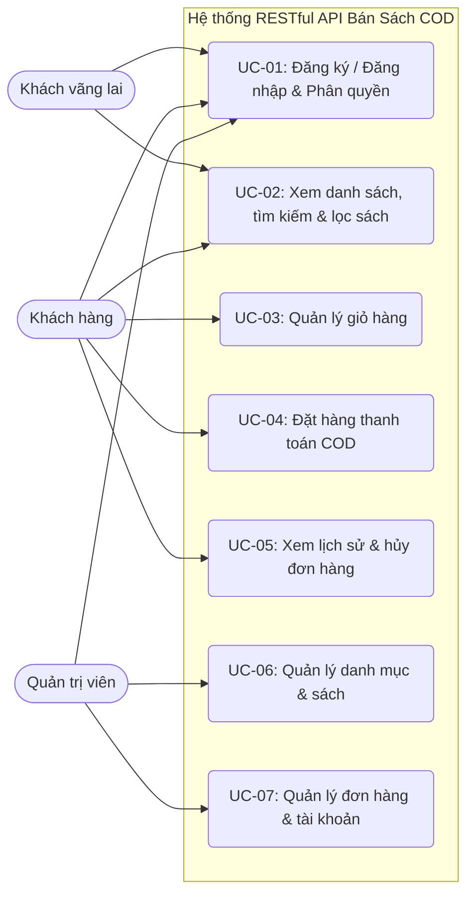
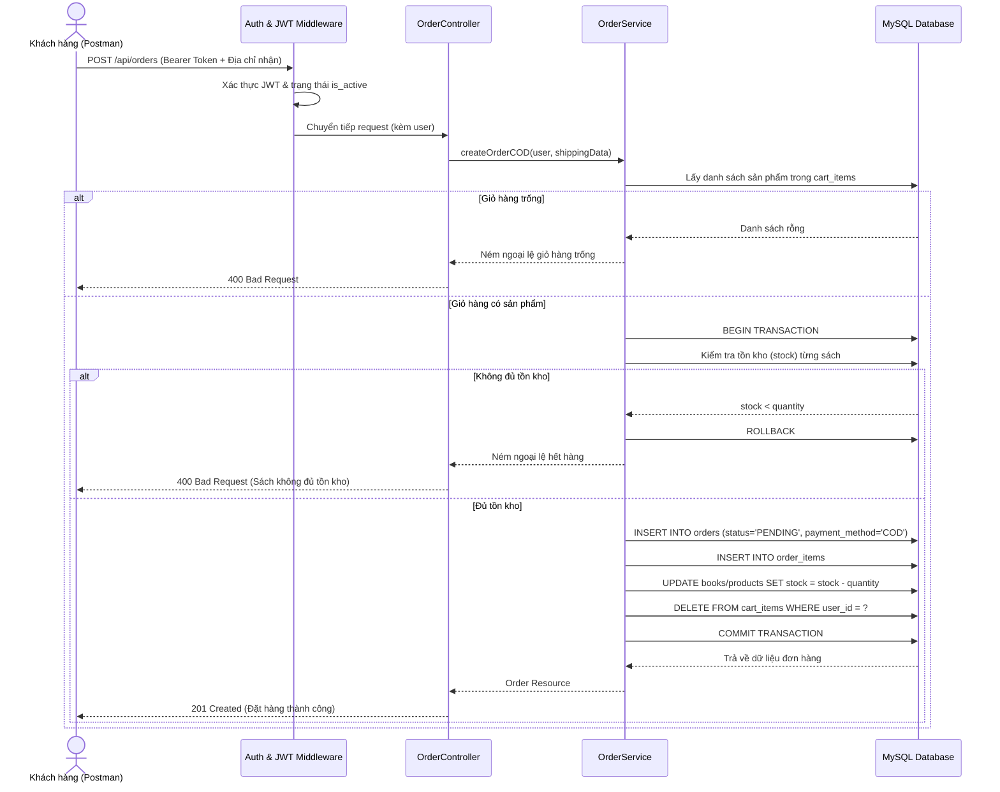

# Đặc tả Use Case – Hệ thống Bán Sách Trực Tuyến (Backend API)

## 1. Sơ đồ Use Case tổng quát

## 2. Đặc tả 3 Use Case cốt lõi

### Use Case 1: Đăng nhập & Phân quyền (TM-03, TM-04)
* **Tác nhân**: Khách hàng, Quản trị viên.
* **Tiền điều kiện**: Người dùng đã có tài khoản trong cơ sở dữ liệu (`users`).
* **Luồng chính**:
  1. Tác nhân gửi request `POST /api/auth/login` kèm `email` và `password`.
  2. Hệ thống xác thực thông tin đăng nhập và kiểm tra trạng thái tài khoản (`is_active = true`).
  3. Hệ thống sinh JWT Token (`auth:api`) và trả về mã `200 OK` kèm thông tin người dùng (`role`).
  4. Khi người dùng gọi các endpoint thuộc nhóm `/api/admin/*`, `CheckAdminMiddleware` kiểm tra điều kiện `role === 'admin'` trước khi cho phép đi tiếp vào Controller.
* **Luồng ngoại lệ**:
  * Sai email hoặc mật khẩu $\rightarrow$ trả về `401 Unauthorized`.
  * Tài khoản bị khóa (`is_active = false`) $\rightarrow$ từ chối truy cập, trả về `403 Forbidden`.
  * Tài khoản khách hàng (`role = customer`) gọi API `/api/admin/*` $\rightarrow$ middleware chặn và trả về `403 Forbidden` kèm thông báo `"Không có quyền truy cập khu vực quản trị"`.

### Use Case 2: Xem danh sách, tìm kiếm & lọc sách (TM-01, TM-02)
* **Tác nhân**: Khách vãng lai, Khách hàng.
* **Tiền điều kiện**: Hệ thống có dữ liệu danh mục và sách trong CSDL.
* **Luồng chính**:
  1. Tác nhân gửi request `GET /api/books` kèm các tham số tùy chọn: `keyword`, `category_id`, `min_price`, `max_price`, `page`.
  2. Hệ thống lọc dữ liệu theo từ khóa (tên sách/tác giả), danh mục, khoảng giá và thực hiện phân trang.
  3. Hệ thống trả về mã `200 OK` cùng danh sách sách và thông tin phân trang.
* **Luồng ngoại lệ**:
  * Không tìm thấy sách phù hợp $\rightarrow$ trả về `200 OK` với mảng `data: []`.

### Use Case 3: Đặt hàng thanh toán khi nhận hàng - COD (TM-06)
* **Tác nhân**: Khách hàng.
* **Tiền điều kiện**: Khách hàng đã đăng nhập (có JWT hợp lệ) và giỏ hàng (`cart_items`) có ít nhất 1 sản phẩm.
* **Luồng chính**:
  1. Khách hàng gửi request `POST /api/orders` kèm thông tin giao hàng (`receiver_name`, `phone`, `shipping_address`, `note`).
  2. Hệ thống lấy toàn bộ sản phẩm trong giỏ hàng của khách hàng.
  3. Hệ thống mở Database Transaction (`DB::beginTransaction()`): kiểm tra số lượng tồn kho (`stock`) của từng sách.
  4. Hệ thống tạo bản ghi mới trong bảng `orders` (`payment_method = 'COD'`, `status = 'PENDING'`), lưu chi tiết vào `order_items`, trừ tồn kho tương ứng ở bảng sách và xóa giỏ hàng.
  5. Commit transaction và trả về mã `201 Created` kèm thông tin đơn hàng vừa tạo.
* **Luồng ngoại lệ**:
  * Giỏ hàng trống $\rightarrow$ trả về `400 Bad Request`.
  * Số lượng đặt mua vượt quá tồn kho hiện tại $\rightarrow$ Rollback transaction và trả về `400 Bad Request` thông báo sản phẩm không đủ số lượng.

## 3. Sequence Diagram – Luồng Đặt hàng (COD)

